# Relatório de Arquitetura, Diagnóstico e Otimizações — ERP Modelagem

**Data do Levantamento**: 19 de Outubro de 2026  
**Ambiente**: Desenvolvimento / Chão de Fábrica  
**Stack**: Vue.js 3 · Tailwind CSS · Node.js (Express 5) · TypeORM · PostgreSQL · TypeScript · Socket.IO · Puppeteer · Docker  

---

## 1. Visão Geral e Contexto de Negócio

### 1.1 Do que se trata o projeto?
O **ERP de Modelagem** é um sistema de chão de fábrica projetado para gerenciar e rastrear o **processo de desenvolvimento, engenharia e prototipagem de calçados** no ambiente industrial do Grupo DASS (atendendo marcas como *Nike*, *Fila*, *Osklen*, *Olympikus*, *Mizuno* e *Adidas*).

Antes de um modelo ser liberado para produção fabril em larga escala, ele passa pela fase crítica de **Ordem de Teste de Produção (OP piloto)**. Esse teste valida molde, comportamento mecânico dos materiais, viabilidade de corte por máquina, tempo de costura, conformação da montagem e adesão estrutural do solado no laboratório.

```mermaid
flowchart LR
    PCP["1. Planejamento (PCP)<br/>Abertura da Ordem"] --> Eng["2. Engenharia de Modelagem<br/>Peças + Rota + Caixa Teste"]
    Eng --> Tickets["3. Geração de Tickets<br/>Lote Principal e Caixa Teste"]
    Tickets --> Corte["4. Chão de Fábrica (Corte)<br/>Lectra, Ponte, Atom, Laser"]
    Corte --> Costura["5. Preparação & Costura<br/>Apoio, Pesponto, Serigrafia"]
    Costura --> Montagem["6. Montagem & Solado<br/>Conformação e Colagem"]
    Montagem --> Lab["7. Laboratório & Qualidade<br/>Tração, FPY e Ensaios"]
    Lab --> Liberado["8. Liberação para Produção<br/>Dossiê Técnico do Modelo"]
```



### 1.2 Conceitos-Chave de Negócio
- **Bifurcação Caixa Teste (CT) vs. Lote Principal (LP)**:
  - *Caixa Teste*: Par piloto antecipado (ex.: tamanho padrão 40 Fila, tamanho 10 Nike) que avança na frente pela esteira fabril para detecção imediata de desvios.
  - *Lote Principal*: Restante das peças do lote de protótipo que percorre o fluxo em seguida. Ambos compartilham o snapshot da rota congelada, mas possuem tickets de identificação, códigos de barras e rastreamentos independentes.
- **Catálogo Dinâmico de Peças (Zero Hardcode)**:
  - 960+ peças anatômicas padronizadas (gáspeas, biqueiras, linguetas, contrafortes, fachetes, taloneiras) catalogadas no sistema e associadas a máquinas específicas de corte.
- **Rotas com Integridade de Engenharia (`validateRouteIntegrity`)**:
  - Toda rota fabril requer validação estrita de compatibilidade entre as peças cadastradas e os subsetores de corte configurados (ex.: obrigatoriedade de peças em Lectra e Ponte). Setores condicionais (como *Telas* e *Serigrafia*) devem operar em sincronia.
- **Modo Quiosque & Bipagem Agnóstica de Hardware**:
  - Leitores de código de barras e crachás RFID nos postos de trabalho. A validação identifica o colaborador e intercepta o perfil no RBAC dinâmico antes de registrar o início ou término do lote no setor.
- **Qualidade Seletiva & Retrabalho Cirúrgico**:
  - *Categoria A*: Handoff automático sem checklist nos setores iniciais.
  - *Categoria B*: Gates mandatórios de inspeção na saída do corte e na montagem/laboratório.
  - *Retrabalho Cirúrgico*: Peças reprovadas geram divergência e retornam obrigatoriamente para reprocessamento no setor causador original.
- **Torre de Controle (BI) & TV de Rastreamento**:
  - Painéis industriais atualizados em tempo real via WebSockets (Socket.IO), calculando Lead Time por modelo, FPY (*First Pass Yield*), índice de retrabalho e mapa de gargalos com fotos das ocorrências.

---

## 2. Estrutura Atual do Repositório

O projeto é estruturado em duas aplicações TypeScript independentes com dependências isoladas:

```
erp-modelagem/
├── backend/                      # API REST Express + TypeORM + PostgreSQL
│   ├── src/
│   │   ├── config/               # Database, CORS, Rate Limits, RBAC, Swagger, Uploads
│   │   ├── controllers/          # Controladores HTTP (Lotes, Rastreamento, Qualidade, BI)
│   │   ├── database/             # Scripts de banco, seeders e importadores CSV
│   │   │   ├── seeds/            # Seeder do catálogo de peças técnicas (Dados.csv)
│   │   │   ├── prepare.ts        # Script de inicialização e criação do schema erp_modelagem
│   │   │   └── seed.ts           # Seeder completo e idempotente de dados operacionais
│   │   ├── entities/             # 38 Entidades mapeadas no TypeORM
│   │   ├── middlewares/          # Auth JWT, RBAC por perfil e setor, Rate Limiters, Tratamento de Erros
│   │   ├── migrations/           # 26 Migrations versionadas TypeORM
│   │   ├── routes/               # Definição das rotas REST organizadas por domínio
│   │   ├── schemas/              # Schemas de validação Zod para payloads e query params
│   │   ├── services/             # Regras de negócio (Auth, Rota, Tickets, Impressão, Dossiê)
│   │   └── server.ts             # Entrypoint da API e servidor WebSocket Socket.IO
│   ├── package.json
│   └── tsconfig.json
│
├── frontend/                     # SPA Vue.js 3 + Vite + Tailwind CSS
│   ├── src/
│   │   ├── api/                  # Clientes HTTP Axios, interceptores de token e auth store
│   │   ├── assets/               # Recursos estáticos e CSS global
│   │   ├── components/           # Componentes compartilhados (RouteBuilder, AdminRBAC, Modais)
│   │   ├── router/               # Vue Router com guardas de navegação e permissões RBAC
│   │   └── views/                # Telas do ERP
│   │       ├── LoginView.vue                 # Autenticação clássica e por aproximação de crachá
│   │       ├── DashboardView.vue             # Shell principal com menu lateral retrátil
│   │       ├── DashboardGerencialView.vue    # Torre de Controle (4 KPIs executivos de BI)
│   │       ├── RastreamentoOrdemView.vue     # TV de Chão de Fábrica com status da esteira
│   │       ├── GestaoOrdensView.vue          # Gestão de OPs, impressão de tickets A4 2x5
│   │       ├── BipagemView.vue               # Tela de quiosque para operadores fabris
│   │       ├── GestaoModelosView.vue         # Catálogo de modelos, ficha técnica e MFM
│   │       ├── CatalogoPecasView.vue         # Gestão de 960+ peças técnicas
│   │       ├── WizardCriacaoTesteView.vue    # Wizard multi-etapas de novas ordens de teste
│   │       └── InspecaoQualidadeView.vue     # Checklists, testes laboratoriais e retrabalhos
│   ├── package.json
│   └── vite.config.ts
│
├── docs/                         # Documentação viva e artefatos de dados
│   ├── Dados.csv                 # Catálogo canônico de peças técnicas de calçados
│   ├── GIT.md                    # Fluxo Git de branches, commits e colaboração
│   └── plano_implementation.md   # Especificação técnica histórica (v1.0 à v5.1)
│
├── IMPLEMENTATION_PLAN.md        # Plano ativo obrigatório de governança e histórico de TASKs
└── AGENTS.md                     # Diretrizes e regras de engenharia do repositório
```

---

## 3. Diagnóstico Técnico: Pontos de Melhoria e Otimização

### 3.1 Banco de Dados & Consultas SQL

| Ponto Identificado | Gravidade | Diagnóstico & Evidência | Recomendação / Boa Prática |
| :--- | :---: | :--- | :--- |
| **Falta de Índices em `rastreamentos`** | **Alta** | A tabela `rastreamentos` possui apenas a chave primária (`id`). Não há índices para as chaves estrangeiras `ordem_teste_id`, `setor_id`, `peca_id`, nem para `status` e `tipo_lote`. | Criar migration com índices compostos:<br>`idx_rastreamentos_ordem_tipo (ordem_teste_id, tipo_lote, status)`<br>`idx_rastreamentos_setor_data (setor_id, data_entrada)`. Evita Full Table Scans na TV e Torre de Controle. |
| **Ausência de Paginação em Listagens** | **Alta** | Em `LotesController.getLotes` e `/api/catalogo-pecas`, todos os registros são retornados de uma só vez com relacionamentos aninhados profundos (`modelo`, `pecas`, `rotas`, `rastreamentos`). | Adicionar paginação (`page`, `limit` / `take`, `skip`) ou busca por cursor. No catálogo de peças, limitar a 50 itens por página com busca por texto. |
| **Busca Textual com `LIKE '%...%'`** | **Média** | A busca de peças técnicas em `pecas.routes.ts` utiliza `LOWER(nome) LIKE :q`, inviabilizando o uso de índices B-Tree normais. | Habilitar a extensão `pg_trgm` no PostgreSQL e criar índice `GIN (nome gin_trgm_ops, numero gin_trgm_ops)` para busca textual instantânea. |
| **Pool de Conexões Não Parametrizado** | **Média** | O `AppDataSource` em `backend/src/config/database.ts` não define `max`, `idleTimeoutMillis` nem `connectionTimeoutMillis`. | Parametrizar o pool no driver `pg` para evitar esgotamento de conexões em ambientes com múltiplos quiosques e WebSockets conectados. |

---

### 3.2 Backend & Arquitetura de Software

| Ponto Identificado | Gravidade | Diagnóstico & Evidência | Recomendação / Boa Prática |
| :--- | :---: | :--- | :--- |
| **Controladores Monolíticos ("Fat Controllers")** | **Alta** | `admin.controller.ts` (1.114 linhas), `lotes.controller.ts` (1.055 linhas) e `rastreamentos.controller.ts` (959 linhas) acumulam validação, regras de negócio, transações e emissão de eventos. | Desacoplar a lógica em serviços especializados (`OrdemWorkflowService`, `RastreamentoHandoffService`, `RbacAdminService`), mantendo os controllers estritamente focados na recepção HTTP e resposta. |
| **Puppeteer Instanciado a Cada Requisição** | **Média** | Em `EtiquetaService.gerarPdfEtiquetas`, cada impressão executa `puppeteer.launch()` e `browser.close()`, consumindo 1–2 segundos e 150MB de RAM por chamada. | Implementar padrão **Browser Pool / Singleton**, reaproveitando a mesma instância do Chromium aberta e criando apenas novas abas (`newPage`), ou adotar biblioteca de renderização direta (`pdfkit`). |
| **Observabilidade e Logs Desestruturados** | **Média** | Uso disperso de `console.log` e `console.error` em arquivos de produção sem formatação padronizada. | Adotar logger estruturado (como `Pino` ou `Winston`) com níveis de log, timestamps ISO, correlation IDs por requisição (`x-request-id`) e suporte a exportação JSON. |
| **Consultas Redundantes no Handshake WebSocket** | **Baixa** | A cada handshake de socket em `websocket.service.ts`, o backend consulta o banco de dados duas vezes para revalidar perfil e permissões. | Implementar cache em memória (ex.: LRU cache ou Redis) para permissões de usuários ativos durante a conexão persistente. |

---

### 3.3 Frontend & Experiência do Usuário (Vue 3)

| Ponto Identificado | Gravidade | Diagnóstico & Evidência | Recomendação / Boa Prática |
| :--- | :---: | :--- | :--- |
| **Componentes de Telas Monolíticos** | **Alta** | `GestaoOrdensView.vue` (2.892 linhas), `BipagemView.vue` (2.103 linhas) e `RastreamentoOrdemView.vue` (1.496 linhas) misturam templates gigantes, modais, formulários e chamadas de API. | Quebrar as views em componentes especializados (ex.: `ModalImprimirTickets.vue`, `ModalHistoricoOrdem.vue`, `CardSetorRastreamento.vue`) e composables reutilizáveis (`useOrdemFiltros.ts`, `useTicketImpressao.ts`). |
| **Falta de Virtualização de Listas Longas** | **Média** | Listas com quase mil itens (Catálogo de Peças) renderizam centenas de nós no DOM simultaneamente. | Adotar **Virtual Scrolling** (`vue-virtual-scroller` ou `@tanstack/vue-virtual`) para renderizar apenas os elementos visíveis na viewport, garantindo 60 FPS em tablets de fábrica. |
| **Gerenciamento de Estado Descentralizado** | **Média** | Não há biblioteca de estado global (Pinia). O estado é gerenciado via `ref`s locais nos componentes e reconsultas HTTP frequentes. | Adotar **Pinia** para centralizar: cache de opções/setores fabris, estado da fila de bipagem offline e eventos recebidos do WebSocket. |
| **Tratamento de Conexão Offline no Quiosque** | **Baixa** | Se a conexão Wi-Fi do chão de fábrica oscilar durante uma bipagem, o operador recebe erro genérico. | Implementar fila local em IndexedDB/LocalStorage com retry automático para bipagens operacionais offline no tablet. |

---

### 3.4 Qualidade, Testes e CI/CD

| Ponto Identificado | Gravidade | Diagnóstico & Evidência | Recomendação / Boa Prática |
| :--- | :---: | :--- | :--- |
| **Ausência de Testes Automatizados** | **Alta** | O comando `npm test` do backend é um placeholder que retorna código 1. Não há testes automatizados para regras complexas de negócio. | Configurar **Vitest** (backend e frontend) e **Supertest** para cobrir regras críticas: `validateRouteIntegrity`, cálculo de SLA descontando pausas, geração de tickets e RBAC. |
| **Ausência de Linting e Formatação Padronizada** | **Média** | Não há ESLint nem Prettier configurados no backend nem no frontend. | Configurar ESLint com `@typescript-eslint` e Prettier integrado com hooks Git (`husky` e `lint-staged`) para assegurar consistência de código. |
| **Automação de CI / CD** | **Média** | Não existem pipelines configurados no repositório (`.github/workflows`). | Criar workflow de CI executando `npm run build` e testes automatizados em cada Pull Request antes do merge na branch `main`. |

---

## 4. Matriz de Priorização (Impacto vs. Esforço)

```
Alto Impacto │  [1] Índices no Banco (rastreamentos)      [2] Paginação no Backend & Frontend
             │  [3] Testes Unitários de Regras Críticas  [4] Fatiar Views Monolíticas (Ordens/Bipagem)
             │
Baixo Impacto│  [5] Pool do Puppeteer                   [6] Setup de ESLint/Prettier
             └─────────────────────────────────────────────────────────────
                                 Baixo Esforço                      Alto Esforço
```

---

## 5. Roadmap Sugerido de Implementação

### Fase 1: Performance Imediata e Estabilidade (Curto Prazo / Baixo Esforço)
1. **Migration de Índices**: Adicionar índices compostos nas tabelas `rastreamentos`, `inspecoes` e `etapas_corte`.
2. **Configuração do Pool PostgreSQL**: Ajustar `extra: { max: 20, ... }` no DataSource.
3. **Reaproveitamento de Browser no Puppeteer**: Instanciar navegador singleton no `EtiquetaService` e `DossieService`.

### Fase 2: Escalabilidade e Usabilidade (Médio Prazo / Médio Esforço)
1. **Paginação na API e Frontend**: Implementar paginação em `LotesController.getLotes` e no catálogo de peças com busca trigram.
2. **Setup de Testes Automatizados (Vitest)**: Criar suíte de testes unitários para os algoritmos de validação de rota e cálculo de Lead Time/SLA.
3. **Padronização de Código**: Configurar ESLint e Prettier no backend e frontend.

### Fase 3: Refatoração Estrutural (Longo Prazo / Alto Impacto)
1. **Fatiamento das Telas Monolíticas**: Dividir `GestaoOrdensView.vue` e `BipagemView.vue` em componentes e composables especializados.
2. **Camada de Serviços Dedicada no Backend**: Extrair regras de negócio de `lotes.controller.ts` e `rastreamentos.controller.ts` para serviços de aplicação limpos.
3. **Pinia & Modo Offline no Quiosque**: Cache global de configurações e fila local resiliente para bipagens de chão de fábrica.
